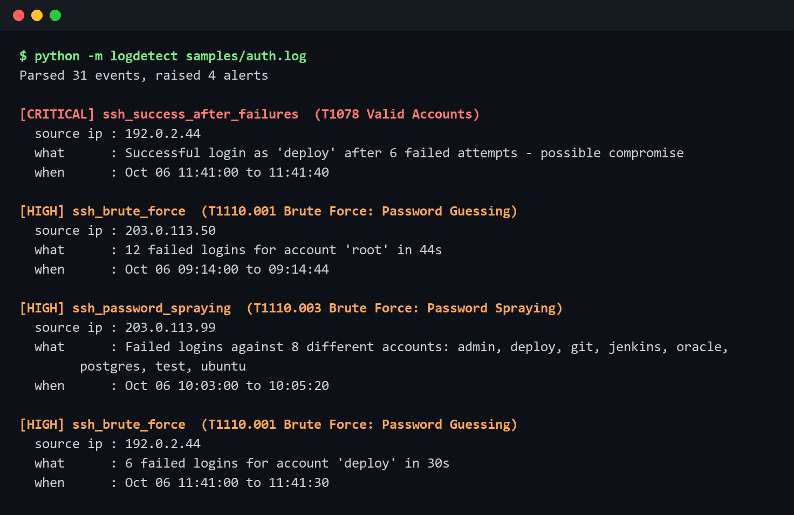

# log-threat-detector

[](https://github.com/Ash86-cpu/log-threat-detector/actions/workflows/tests.yml)



A Python command-line tool that reads SSH authentication logs and web server
access logs, detects common attacks, and reports them as alerts mapped to
[MITRE ATT&CK](https://attack.mitre.org/) techniques.

It is a small-scale version of what a SIEM detection pipeline does: parse raw
logs into structured events, run detection rules over them, and hand an analyst
a prioritised list of findings.

No third-party dependencies are needed to run it; only the Python standard library.

## What it detects

| Rule | Log | Fires when | Severity | ATT&CK |
|---|---|---|---|---|
| `ssh_brute_force` | SSH | One IP fails 5+ logins on the same account within 5 minutes | High | [T1110.001](https://attack.mitre.org/techniques/T1110/001/) Password Guessing |
| `ssh_password_spraying` | SSH | One IP fails logins on 5+ different accounts within 10 minutes | High | [T1110.003](https://attack.mitre.org/techniques/T1110/003/) Password Spraying |
| `ssh_success_after_failures` | SSH | A login succeeds after 3+ failures from the same IP | Critical | [T1078](https://attack.mitre.org/techniques/T1078/) Valid Accounts |
| `web_sql_injection` | Web | A request URL contains SQL injection payloads | High | [T1190](https://attack.mitre.org/techniques/T1190/) Exploit Public-Facing Application |
| `web_path_traversal` | Web | A request tries to escape the web root or read system files | High | [T1190](https://attack.mitre.org/techniques/T1190/) Exploit Public-Facing Application |
| `web_scanner` | Web | The User-Agent belongs to a known scanning tool | Medium | [T1595.002](https://attack.mitre.org/techniques/T1595/002/) Vulnerability Scanning |

## Quick start

Requires Python 3.10 or newer.

```bash
git clone https://github.com/Ash86-cpu/log-threat-detector.git
cd log-threat-detector

python -m logdetect samples/auth.log
python -m logdetect samples/access.log --type web
```

## Example output

```
$ python -m logdetect samples/auth.log
Parsed 31 events, raised 4 alerts

[CRITICAL] ssh_success_after_failures  (T1078 Valid Accounts)
  source ip : 192.0.2.44
  what      : Successful login as 'deploy' after 6 failed attempts - possible compromise
  when      : Oct 06 11:41:00 to 11:41:40

[HIGH] ssh_brute_force  (T1110.001 Brute Force: Password Guessing)
  source ip : 203.0.113.50
  what      : 12 failed logins for account 'root' in 44s
  when      : Oct 06 09:14:00 to 09:14:44

[HIGH] ssh_password_spraying  (T1110.003 Brute Force: Password Spraying)
  source ip : 203.0.113.99
  what      : Failed logins against 8 different accounts: admin, deploy, git, jenkins, oracle, postgres, test, ubuntu
  when      : Oct 06 10:03:00 to 10:05:20

[HIGH] ssh_brute_force  (T1110.001 Brute Force: Password Guessing)
  source ip : 192.0.2.44
  what      : 6 failed logins for account 'deploy' in 30s
  when      : Oct 06 11:41:00 to 11:41:30
```

```
$ python -m logdetect samples/access.log --type web --min-severity high
Parsed 27 events, raised 2 alerts

[HIGH] web_sql_injection  (T1190 Exploit Public-Facing Application)
  source ip : 203.0.113.77
  what      : SQL injection: 5 requests, e.g. /item?id=1' OR '1'='1 (3 returned HTTP 200 - check for impact)
  when      : Oct 06 12:03:14 to 12:03:22

[HIGH] web_path_traversal  (T1190 Exploit Public-Facing Application)
  source ip : 203.0.113.88
  what      : Path traversal: 3 requests, e.g. /download?file=../../../../etc/passwd (1 returned HTTP 200 - check for impact)
  when      : Oct 06 12:07:35 to 12:07:45
```

## Response playbook (SOAR)

Detection answers *what happened*. With `--respond`, alerts then run through a
small SOAR-style playbook that answers *what do we do about it*, the same
steps a platform like Splunk SOAR, Cortex XSOAR, Tines or a Sentinel playbook runs:

| Step | What it does here | In production this would be |
|---|---|---|
| 1. Enrich | Looks up each source IP in `samples/threat_intel.json` (reputation, country, tags, allowlist) | AbuseIPDB / VirusTotal / a TI platform API |
| 2. Decide | Applies response rules: **block**, **escalate** to a human, or **monitor** | Playbook decision blocks |
| 3. Act | Appends IPs to `output/blocklist.txt`, writes tickets to `output/incidents.json` | Firewall / EDR API, Jira or ServiceNow |
| 4. Notify | Prints a response summary for the analyst | Slack / Teams / email |
| 5. Record | Appends every decision and its reason to `output/audit.log` | SOAR case history |

The decision rules, checked in order (safety rules first):

1. Allowlisted IP (e.g. our own scanner) → **monitor**, never auto-blocked
2. Critical alert (login succeeded after failures) → **escalate**: blocking the
   IP does not help if the attacker is already in; a human must reset
   credentials and investigate
3. IP listed as malicious → **block**
4. High severity, IP suspicious or unknown → **escalate**: not confident enough to act alone
5. Anything else → **monitor**

```bash
python -m logdetect samples/auth.log --respond --dry-run   # show what would happen
python -m logdetect samples/auth.log --respond             # actually write output/
```

```
Response playbook (DRY RUN - nothing was written)

[ESCALATE] 192.0.2.44      ssh_success_after_failures   intel: suspicious
             why: Possible account compromise: blocking the IP is not enough, a human must reset credentials and investigate
             next steps for the analyst:
               - Disable or reset the password of the account that logged in ('deploy')
               - Review what that account did after the successful login (commands, files, new keys)
               - Check ~/.ssh/authorized_keys and cron jobs for persistence added by the attacker
               - Block 192.0.2.44 once the compromise is confirmed
               - Search other servers' logs for activity from 192.0.2.44
[BLOCK   ] 203.0.113.50    ssh_brute_force              intel: malicious
             why: Attack from an IP that threat intel lists as malicious
[BLOCK   ] 203.0.113.99    ssh_password_spraying        intel: malicious
             why: Attack from an IP that threat intel lists as malicious
[ESCALATE] 192.0.2.44      ssh_brute_force              intel: suspicious
             why: High-severity attack but IP reputation is suspicious; not confident enough to auto-block

Blocked 2 new IPs, opened 2 incidents for a human, monitored the rest.
```

Every escalated alert carries a checklist of **recommended next steps** for the
analyst, specific to the rule that fired (with the IP and account filled in),
both on screen and in each ticket in `incidents.json`.

`--dry-run` shows the decisions without writing anything, the way new
playbooks are tested before they are allowed to act. An IP is only added to
the blocklist once, across alerts and across runs. The playbook tests include
safety tests proving an allowlisted IP is never blocked and a critical alert
always reaches a human, whatever threat intel says.

## Options

| Option | Purpose |
|---|---|
| `--type ssh\|web` | Kind of log to analyse (default: `ssh`) |
| `--format text\|json` | Human-readable text or machine-readable JSON (default: `text`) |
| `--output FILE` | Write the report to a file instead of the terminal |
| `--min-severity critical\|high\|medium` | Hide alerts below this severity (default: `medium`) |
| `--year YEAR` | Year an SSH log was written, since syslog lines omit it (default: current year) |

JSON output is intended for feeding other tools:

```bash
python -m logdetect samples/auth.log --format json --output report.json
```

```json
{
  "summary": {
    "events_parsed": 31,
    "alerts_raised": 4,
    "by_severity": { "critical": 1, "high": 3 }
  },
  "alerts": [
    {
      "rule": "ssh_success_after_failures",
      "severity": "critical",
      "mitre_id": "T1078",
      "mitre_name": "Valid Accounts",
      "source_ip": "192.0.2.44",
      "description": "Successful login as 'deploy' after 6 failed attempts - possible compromise",
      "first_seen": "2026-10-06T11:41:00",
      "last_seen": "2026-10-06T11:41:40",
      "event_count": 7
    }
  ]
}
```

(Trimmed to the first alert.)

## How it works

```
raw log file  ->  parser.py  ->  Event / WebRequest  ->  detection rules  ->  Alert  ->  report.py
```

| File | Responsibility |
|---|---|
| `logdetect/parser.py` | Regular expressions that turn raw log lines into structured objects |
| `logdetect/models.py` | The `Event`, `WebRequest` and `Alert` data classes |
| `logdetect/detections.py` | SSH rules: counts of events inside sliding time windows |
| `logdetect/web_detections.py` | Web rules: signature matching on each request |
| `logdetect/report.py` | Text and JSON output, severity filtering |
| `logdetect/__main__.py` | Command-line interface |

Design decisions:

- **Normalise first, detect second.** Rules work on structured objects and never
  see raw log text, so supporting a new log format only means writing a parser.
- **Two detection styles.** The SSH rules are behavioural (thresholds over time
  windows); the web rules are signature-based (patterns in a single request).
- **Password spraying has its own rule.** One attempt per account never reaches
  a per-account brute force threshold, so it is detected by counting distinct
  usernames per source IP instead.
- **Payloads are URL-decoded before matching**, so `%27%20OR%20` is caught the
  same as `' OR `.
- **One alert per attacker per rule.** A scanner sending hundreds of requests
  produces a single alert with a count, not hundreds of alerts.
- **Files are read line by line**, so large logs do not need to fit in memory.

## Tests

```bash
pip install -r requirements-dev.txt
python -m pytest -v
```

53 tests cover the parsers, every rule, the report formats and the response playbook. Each rule is
tested both ways: that it fires on an attack, and that it stays quiet on normal
behaviour such as a user mistyping a password once, or a search for
"credit union rates". GitHub Actions runs the suite on Python 3.10 and 3.12 on
every push.

## Limitations

This is a learning project, not a replacement for a SIEM. Known gaps:

- It analyses a finished log file; it does not watch logs in real time.
- Thresholds are fixed defaults in the code and are not yet configurable from
  the command line.
- An attacker who spreads attempts across many IP addresses, or goes slowly
  enough to stay under the time windows, will not be detected.
- The web signatures cover common payloads only and inspect the URL, not
  request bodies, so POST-based attacks are missed.
- Scanner detection relies on the User-Agent header, which is trivial to fake.
- Only OpenSSH syslog format and the nginx/Apache combined log format are parsed.

## Sample data

The logs in `samples/` are synthetic. All addresses come from the ranges
reserved for documentation by RFC 5737 (`192.0.2.0/24`, `198.51.100.0/24`,
`203.0.113.0/24`), so no real hosts are referenced.

## License

MIT. See [LICENSE](LICENSE).
